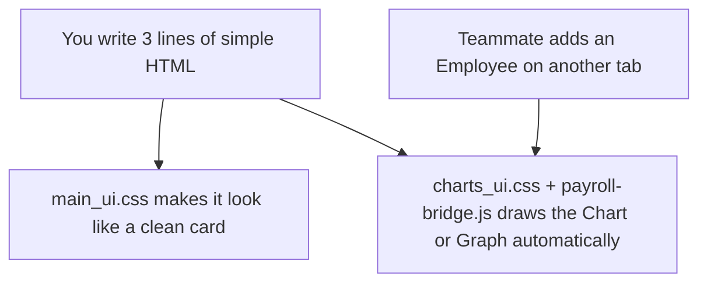

# Payroll Management System: Developer & AI Reference Manual

> [!IMPORTANT]
> **FOR STUDENTS & AI ASSISTANTS:** This document uses **ASD-STE100 (Simplified Technical English)**. Every code example is broken into small, bite-sized steps so you never have to read a giant wall of code.
> * **If you are a Student:** Treat this guide like a Lego manual. Copy one small block at a time and test it in Live Preview.
> * **If you are an AI Assistant:** Use only the exact classes, `--variables`, and `data-` attributes listed here. Never output giant unformatted walls of code without comments.

---

## Table of Contents
1. [System Overview: How Your Page Works](#section-1-system-overview-how-your-page-works)
2. [Project Folder Structure (Where Everything Lives)](#section-2-project-folder-structure-where-everything-lives)
3. [How Automatic Styling Works (`main_ui.css`)](#section-3-how-automatic-styling-works-main_uicss)
4. [How Shared Data & Auto-Graphs Work (`payroll-bridge.js`)](#section-4-how-shared-data--auto-graphs-work-payroll-bridgejs)
5. [Master HTML Starter Template (Broken Into 3 Easy Pieces)](#section-5-master-html-starter-template-broken-into-3-easy-pieces)
6. [Page Layout & Grid System (Side-by-Side Boxes)](#section-6-page-layout--grid-system-side-by-side-boxes)
7. [KPI Summary Cards & Status Badges](#section-7-kpi-summary-cards--status-badges)
8. [Master Catalog: All 12 Available Charts & Graphs](#section-8-master-catalog-all-12-available-charts--graphs)
9. [How to Add Charts (Category Comparisons & Progress)](#section-9-how-to-add-charts-category-comparisons--progress)
10. [How to Add True Graphs (Trend Lines, Waves & Coordinates)](#section-10-how-to-add-true-graphs-trend-lines-waves--coordinates)
11. [How to Make Numbers, Charts & Graphs Dynamic](#section-11-how-to-make-numbers-charts--graphs-dynamic)
12. [Automatic Tables & Data Lists](#section-12-automatic-tables--data-lists)
13. [Forms, Inputs & Saving Data Easily](#section-13-forms-inputs--saving-data-easily)
14. [Adding Your Own Custom CSS Safely](#section-14-adding-your-own-custom-css-safely)
15. [Testing in Live Preview & AI Prompt Cheat-Sheet](#section-15-testing-in-live-preview--ai-prompt-cheat-sheet)
16. [Mobile Responsiveness (Making It Look Like an App)](#section-16-mobile-responsiveness-making-it-look-like-an-app)
17. [Backend & Database Integration (For the Backend Team)](#section-17-backend--database-integration-for-the-backend-team)
18. [**NEW!** Global Data Dictionary & Implementation Guide](#section-18-global-data-dictionary--implementation-guide)

---

## Section 1: System Overview: How Your Page Works

You do **not** need to be a JavaScript expert to build a tab in this Payroll System.

* **You work in your own file:** You only edit your assigned HTML file inside the `/modules/` folder (for example, `tab-employees.html`).
* **You do not touch `index.html`:** The main sidebar and top menu are handled automatically.
* **Everything works in Live Preview:** When you open your file in VS Code, it immediately shows the real colors, cards, charts, and graphs.



---

## Section 2: Project Folder Structure (Where Everything Lives)

Only edit the files marked **YOUR WORKSPACE**. Do not move or rename the core engine files.

```text
/payroll-assignment
│── index.html                    <-- DO NOT EDIT: Master navigation shell
│── DEVELOPER_GUIDE.md            <-- THIS MANUAL: Share with teammates & AI
│
│── css/
│   ├── main_ui.css               <-- DO NOT EDIT: Styles all basic HTML tags
│   ├── charts_ui.css             <-- DO NOT EDIT: Draws all 12 Charts & Graphs
│   └── modules/                  <-- YOUR CUSTOM CSS: Optional extra styles for your tab
│       ├── dashboard.css
│       ├── employees.css
│       ├── payroll.css
│       ├── compliance.css
│       └── payslips.css
│
│── js/
│   ├── shell-router.js           <-- DO NOT EDIT: Switches tabs in the sidebar
│   └── payroll-bridge.js         <-- DO NOT EDIT: Calculates pay & draws line graphs
│
└── modules/                      <-- YOUR WORKSPACE: Open your assigned file here!
    ├── tab-dashboard.html
    ├── tab-employees.html
    ├── tab-payroll.html
    ├── tab-compliance.html
    └── tab-payslips.html
```

---

## Section 3: How Automatic Styling Works (`main_ui.css`)

In normal web design, you have to write CSS rules for every heading, paragraph, button, and table. **In our system, `main_ui.css` does that for you automatically.**

### What Happens When You Type Basic HTML:
| When You Type This Tag... | What `main_ui.css` Automatically Does |
| :--- | :--- |
| `<h1>Page Title</h1>` | Makes it a bold, dark navy dashboard title. |
| `<p class="text-muted">Text</p>` | Makes it clean, soft grey subtitle text. |
| `<div class="card">...</div>` | Wraps your content in a white box with rounded corners and a soft shadow. |
| `<button class="btn-primary">` | Turns the button into a styled action button with hover effects. |
| `<table>...</table>` | Formats rows, borders, and spacing cleanly without extra classes. |

### Theme Colors You Can Use Anywhere:
Whenever a chart or graph asks for a color, type one of these variable names:
* `var(--primary)` — Main Blue
* `var(--success)` — Paid / Completed Green
* `var(--warning)` — Pending Orange
* `var(--danger)` — Alert / Deduction Red
* `var(--purple)` — Category Purple
* `var(--teal)` — Net Payout Teal

---

## Section 4: How Shared Data & Auto-Graphs Work (`payroll-bridge.js`)

You might wonder: *"How can I draw a complex Line Graph or update numbers across tabs if I don't know JavaScript?"*

**The secret is `payroll-bridge.js`.** It runs silently in the background of your page and does three jobs:
1. **It listens for `data-` tags:** When it sees `<div class="line-graph" data-points="30, 50, 45, 80, 95">`, it automatically draws the SVG trend line, dots, and grid lines for you!
2. **It stores shared payroll data:** When someone adds an employee or calculates hours on one tab, `payroll-bridge.js` saves it in the browser.
3. **It auto-updates all pages:** Any number or chart with a `data-bind` attribute updates itself the instant payroll data changes.

---

## Section 5: Master HTML Starter Template (Broken Into 3 Easy Pieces)

Instead of looking at one big file, every page is just **3 small pieces** stacked together:

### Piece 1: The `<head>` (Connects your page to the styles and graphs)
This goes at the very top of your file. You only change line 9 (`dashboard.css`) to match your tab's name.
```html
<!DOCTYPE html>
<html lang="en">
<head>
  <meta charset="UTF-8">
  <title>My Payroll Tab</title>
  <link rel="stylesheet" href="../css/main_ui.css">
  <link rel="stylesheet" href="../css/charts_ui.css">
  <link rel="stylesheet" href="../css/modules/dashboard.css"> <!-- Change to your css file -->
  <script defer src="../js/payroll-bridge.js"></script>
</head>
```

### Piece 2: The `<header>` (Your page title and top button)
This goes right after `<head>`. It creates the top bar of your tab.
```html
<body class="module-canvas">

  <header class="module-header">
    <div>
      <h1>Payroll Dashboard</h1>
      <p class="text-muted">Overview of monthly salary costs and statutory compliance.</p>
    </div>
    <button class="btn-primary">+ Run Payroll</button>
  </header>
```

### Piece 3: The `<main>` Workspace (Where you build your boxes!)
Everything you build goes inside `<main class="module-content">`.
```html
  <main class="module-content">

    <!-- PUT YOUR CARDS, CHARTS, AND GRAPHS HERE! -->
    <div class="card">
      <h2>My First Card</h2>
      <p>This box is automatically styled.</p>
    </div>

  </main>

</body>
</html>
```

---

## Section 6: Page Layout & Grid System (Side-by-Side Boxes)

Want to put cards side-by-side in a row? Wrap your `<div class="card">` boxes inside a **Grid Wrapper**.

| Wrapper Class | What It Does | Best Used For |
| :--- | :--- | :--- |
| `<div class="grid-4">` | Puts **4 boxes** side-by-side | Top row of 4 KPI number cards |
| `<div class="grid-3">` | Puts **3 boxes** side-by-side | Middle row of 3 charts |
| `<div class="grid-2">` | Puts **2 boxes** side-by-side (50% / 50%) | Two medium graphs or form columns |
| `<div class="grid-2-1">` | Left box wide (65%), Right box narrow (35%) | Main table on left + summary chart on right |

### Simple Example (2 Cards Side-by-Side):
```html
<div class="grid-2">
  <div class="card">Left Box</div>
  <div class="card">Right Box</div>
</div>
```

---

## Section 7: KPI Summary Cards & Status Badges

KPI Cards are the small summary boxes at the top of the screen (like **Total Employees: 1,248**).

### How to Build a KPI Card in 6 Lines:
```html
<div class="card kpi-card">
  <div class="kpi-icon icon-green">👥</div>
  <div class="kpi-details">
    <span class="kpi-label">Total Employees</span>
    <h2 data-bind="total-employees">1,248</h2>
  </div>
  <span class="trend-up">+18 vs last month</span>
</div>
```

**Plain English Breakdown:**
* `icon-green` sets the circle color (you can also use `icon-blue`, `icon-teal`, or `icon-purple`).
* `data-bind="total-employees"` tells our script to replace `1,248` with the real number of employees automatically.
* `trend-up` makes the text green (use `trend-down` for red).

### Status Badges (One Line Only!):
Drop any of these inside a table or list:
```html
<span class="badge badge-paid">Paid ✓</span>
<span class="badge badge-pending">Pending ⏳</span>
<span class="badge badge-completed">Completed</span>
<span class="badge badge-danger">Overdue !</span>
```

---

## Section 8: Master Catalog: All 12 Available Charts & Graphs

We provide **6 Charts** (for categories, slices, and progress) and **6 True Graphs** (for trends over time, waves, and X/Y coordinates).

### Part A: Charts (Categories, Donuts, Rings & Bars)
| # | Chart Type | Best Used For | Class Name | Variable / Attribute You Set |
| :--- | :--- | :--- | :--- | :--- |
| **1** | **Circular Ring Chart** | Single % goal (*Payslip Progress 92%*) | `.ring-chart` | `style="--percent: 92;"` |
| **2** | **Multi-Slice Donut Chart** | Cost breakdown (*Salary Cost Summary*) | `.donut-chart` | `style="--s1: 40; --s2: 25; --s3: 20;"` |
| **3** | **Vertical Bar Chart** | Comparing amounts (*PAYE, NIS, NHT*) | `.bar-chart` | `style="--height: 85%;"` on each bar |
| **4** | **Horizontal Bar Chart** | Department costs (*IT, HR, Finance, Sales*) | `.hbar-chart` | `style="--width: 70%;"` on each row |
| **5** | **Semi-Circle Gauge Meter** | Budget / Overtime limit speedometer | `.gauge-chart` | `style="--gauge: 68;"` (0 to 100) |
| **6** | **Stacked Gross-to-Net Bar** | Showing Net Pay vs. Taxes in one bar | `.stacked-bar` | `style="--width: 74%;"` per segment |

### Part B: True Graphs (Trend Lines, Area Waves, Multi-Line & Heatmaps)
| # | Graph Type | Best Used For | Class Name | Attribute You Set (Auto-Drawn!) |
| :--- | :--- | :--- | :--- | :--- |
| **7** | **Single Line Trend Graph** | Monthly payroll cost from Jan to Jun | `.line-graph` | `data-points="40, 52, 48, 70, 85, 92"` |
| **8** | **Smooth Area Wave Graph** | Shaded Net Payout growth over time | `.area-graph` | `data-points="30, 45, 60, 55, 80, 95"` |
| **9** | **Multi-Line Comparison Graph** | Two lines: *Gross Pay* vs *Net Pay* over 6 mos | `.multiline-graph` | `data-line-a="60,70,80"` & `data-line-b="45,52,60"` |
| **10** | **Grouped Side-by-Side Graph** | *This Month* vs *Last Month* taxes | `.grouped-graph` | `style="--h1: 80%; --h2: 65%;"` per pair |
| **11** | **Waterfall Step Graph** | How Gross Pay steps down to Net Pay | `.waterfall-graph` | `style="--start: 0%; --size: 100%;"` |
| **12** | **Attendance Heatmap Grid** | 30-day employee attendance / leave grid | `.heatmap-grid` | `data-level="1"` to `"4"` (color intensity) |

---

## Section 9: How to Add Charts (Category Comparisons & Progress)

Here is how to add any of the **6 Charts** using tiny, easy-to-read blocks of HTML.

### 1. Circular Ring Chart (3 Lines of Code)
```html
<div class="ring-chart" style="--percent: 92; --ring-color: var(--success);">
  <div class="ring-inner"> <h2>92%</h2> <small>Generated</small> </div>
</div>
```
* **How to customize:** Change `92` to any number from `0` to `100`.

---

### 2. Multi-Slice Donut Chart (5 Lines of Code)
```html
<div class="donut-chart" style="--s1: 40; --s2: 25; --s3: 20; --s4: 15;">
  <div class="donut-inner">
    <h3>$4.39M</h3> <small>Total Cost</small>
  </div>
</div>
```
* **How to customize:** `--s1`, `--s2`, `--s3`, and `--s4` are the percentages of the 4 colored slices (they should add up to 100 or less).

---

### 3. Vertical Bar Chart (1 Line Per Bar)
```html
<div class="bar-chart">
  <div class="bar-col" style="--height: 88%;" data-value="$88K" data-label="PAYE"></div>
  <div class="bar-col" style="--height: 65%;" data-value="$65K" data-label="NIS"></div>
  <div class="bar-col" style="--height: 22%;" data-value="$21K" data-label="NHT"></div>
</div>
```
* **How to customize:** Copy and paste a `<div class="bar-col">` line to add another bar. Change `--height` for the bar height, `data-value` for the top number, and `data-label` for the bottom label.

---

### 4. Horizontal Bar Chart (Great for Department Comparisons)
```html
<div class="hbar-chart">
  <div class="hbar-row" style="--width: 85%;" data-label="Engineering" data-value="$1.8M"></div>
  <div class="hbar-row" style="--width: 55%;" data-label="Operations" data-value="$1.1M"></div>
  <div class="hbar-row" style="--width: 30%;" data-label="HR & Admin" data-value="$620K"></div>
</div>
```

---

### 5. Semi-Circle Gauge Speedometer (Overtime or Budget Cap)
```html
<div class="gauge-chart" style="--gauge: 72; --gauge-color: var(--warning);">
  <div class="gauge-label"> <h3>72%</h3> <small>Overtime Budget Used</small> </div>
</div>
```

---

### 6. Stacked Gross-to-Net Ratio Bar
Shows how a paycheck is split between Take-Home Pay, Taxes, and Benefits in one sleek horizontal bar:
```html
<div class="stacked-bar">
  <div class="stack-segment bg-teal" style="--width: 74%;" title="Net Pay: 74%">74% Net</div>
  <div class="stack-segment bg-primary" style="--width: 18%;" title="PAYE & Tax: 18%">18% Tax</div>
  <div class="stack-segment bg-purple" style="--width: 8%;" title="NIS/NHT: 8%">8%</div>
</div>
```

---

## Section 10: How to Add True Graphs (Trend Lines, Waves & Coordinates)

True graphs plot points across an X-axis (like months) and a Y-axis (like dollar amounts). 
**You do not need to draw SVG paths yourself!** Just type your comma-separated numbers inside `data-points="..."` and `payroll-bridge.js` draws the entire coordinate graph automatically.

### 7. Single Line Trend Graph (2 Lines of Code!)
Plots a connected line graph with glowing data dots at each month:
```html
<div class="line-graph" 
     data-points="42, 48, 45, 68, 82, 95" 
     data-labels="Jan, Feb, Mar, Apr, May, Jun"
     data-color="var(--primary)">
</div>
```
* **Plain English Breakdown:**
  * `data-points`: Your heights from 0 to 100 for each point on the line.
  * `data-labels`: The X-axis labels shown along the bottom of the graph.
  * `data-color`: The color of the trend line and dots.

---

### 8. Smooth Area Wave Graph (Shaded Trend Graph)
Looks just like a modern financial stock graph with a soft gradient fill underneath the line:
```html
<div class="area-graph" 
     data-points="30, 50, 45, 75, 70, 96" 
     data-labels="Jan, Feb, Mar, Apr, May, Jun"
     data-color="var(--teal)">
</div>
```

---

### 9. Multi-Line Comparison Graph (Compare 2 Trends at Once!)
Want to plot **Gross Salary** (Line A) against **Net Payout** (Line B) on the same graph?
```html
<div class="multiline-graph" 
     data-line-a="65, 70, 72, 85, 90, 98" 
     data-label-a="Gross Pay"
     data-line-b="48, 52, 54, 63, 67, 73" 
     data-label-b="Net Payout"
     data-labels="Jan, Feb, Mar, Apr, May, Jun">
</div>
```

---

### 10. Grouped Side-by-Side Comparison Graph (This Month vs. Last Month)
Places two bars side-by-side for each category so you can compare two months:
```html
<div class="grouped-graph">
  <div class="group-pair" style="--h1: 75%; --h2: 85%;" data-label="PAYE"></div>
  <div class="group-pair" style="--h1: 60%; --h2: 65%;" data-label="NIS"></div>
  <div class="group-pair" style="--h1: 35%; --h2: 40%;" data-label="NHT"></div>
</div>
```
* `--h1` is Last Month's bar (grey-blue). `--h2` is This Month's bar (primary blue).

---

### 11. Waterfall Step Graph (How Gross Pay Steps Down to Net Pay)
Great for the **Payslips** or **Payroll** tab to visually show how deductions subtract from Gross Pay:
```html
<div class="waterfall-graph">
  <div class="wf-step wf-total" style="--bottom: 0%; --size: 100%;" data-label="Gross" data-val="$100K"></div>
  <div class="wf-step wf-minus" style="--bottom: 82%; --size: 18%;" data-label="-PAYE" data-val="-$18K"></div>
  <div class="wf-step wf-minus" style="--bottom: 74%; --size: 8%;"  data-label="-NIS/NHT" data-val="-$8K"></div>
  <div class="wf-step wf-net"   style="--bottom: 0%; --size: 74%;"  data-label="Net Pay" data-val="$74K"></div>
</div>
```

---

### 12. Attendance / Leave Heatmap Grid
Creates a visual calendar grid where darker squares mean more overtime or leave taken:
```html
<div class="heatmap-grid" data-heatmap="attendance">
  <span data-level="1" title="Day 1: Full Attendance"></span>
  <span data-level="3" title="Day 2: Overtime"></span>
  <span data-level="0" title="Day 3: Leave"></span>
  <span data-level="2" title="Day 4: Full Attendance"></span>
</div>
```

---

## Section 11: How to Make Numbers, Charts & Graphs Dynamic

When Teammate A adds a new employee or Teammate B changes hourly rates, your page can update its numbers and redraw its graphs automatically!

### Step 1: Auto-Updating Text Numbers (`data-bind`)
Add `data-bind="NAME"` to any `<span>`, `<h2>`, or `<strong>` tag:
```html
<h2 data-bind="total-employees">0</h2>
<h2 data-bind="total-salary-cost">$0</h2>
<h2 data-bind="total-net-payout">$0</h2>
<h2 data-bind="total-deductions">$0</h2>
```

### Step 2: Auto-Updating Charts & Graphs (`data-auto-chart`)
Add `data-auto-chart="NAME"` to a chart or graph container, and `payroll-bridge.js` will automatically calculate the percentages and redraw it whenever employee data changes:

| Attribute to Add | What It Automatically Updates |
| :--- | :--- |
| `data-auto-chart="payslip-ring"` | Updates `--percent` on a `.ring-chart` based on % of payslips completed |
| `data-auto-chart="deductions-bars"` | Updates `--height` and `data-value` on PAYE, NIS, NHT, and Ed Tax bars |
| `data-auto-chart="salary-donut"` | Updates `--s1` to `--s4` slices on the Salary Cost Donut |
| `data-auto-chart="payroll-trend"` | Updates `data-points` on a `.line-graph` or `.area-graph` with monthly totals |
| `data-auto-chart="gross-vs-net"` | Updates both lines on a `.multiline-graph` with real Gross vs. Net history |

---

## Section 12: Automatic Tables & Data Lists

To build a clean data table, just write a normal HTML `<table>` inside a `<div class="card">`.

### Simple 2-Row Table Example:
```html
<div class="card">
  <h3>Recent Payroll Runs</h3>
  <table>
    <thead>
      <tr>
        <th>Month</th> <th>Employees</th> <th>Gross Cost</th> <th>Status</th>
      </tr>
    </thead>
    <tbody data-table="payroll-runs">
      <tr>
        <td>May 2026</td> <td>1,248</td> <td>$4,387,482</td>
        <td><span class="badge badge-completed">Completed</span></td>
      </tr>
    </tbody>
  </table>
</div>
```
* **Bonus Trick:** If you put `data-table="employees-list"` on your `<tbody>`, `payroll-bridge.js` will automatically fill the table rows with every employee saved in the system!

---

## Section 13: Forms, Inputs & Saving Data Easily

Need a form that saves a new employee or updates hours without writing complicated JavaScript? Use **`data-form="add-employee"`**!

### Zero-JS Auto-Saving Form:
Because this `<form>` has `data-form="add-employee"`, `payroll-bridge.js` automatically captures the inputs, calculates taxes, saves the employee, and updates all charts when the user clicks the button!

```html
<div class="card">
  <h3>Add Employee</h3>
  
  <form data-form="add-employee">
    <div class="grid-2">
      <div class="form-group">
        <label>Employee Name</label>
        <input type="text" name="name" placeholder="Marcia Campbell" required>
      </div>
      <div class="form-group">
        <label>TRN Number</label>
        <input type="text" name="trn" placeholder="123-456-789" required>
      </div>
      <div class="form-group">
        <label>Hourly Rate ($)</label>
        <input type="number" name="hourlyRate" placeholder="2500" required>
      </div>
      <div class="form-group">
        <label>Hours Worked</label>
        <input type="number" name="hoursWorked" value="160" required>
      </div>
    </div>
    <button type="submit" class="btn-primary">Save Employee</button>
  </form>
</div>
```

---

## Section 14: Adding Your Own Custom CSS Safely

If you want to design a custom box for your tab:
1. Open **only** your assigned CSS file in `css/modules/` (e.g., `css/modules/employees.css`).
2. Do **not** edit `main_ui.css` or `charts_ui.css`.
3. Use our theme variables (`var(--primary)`, `var(--card-bg)`) so your colors match everyone else's tab.

---

## Section 15: Testing in Live Preview & AI Prompt Cheat-Sheet

### How to Preview Your Page:
1. Open VS Code.
2. Right-click your HTML file in `/modules/` (for example, `modules/tab-dashboard.html`).
3. Click **"Show Preview"** (Live Preview) or **"Open with Live Server"**.
4. Every chart, line graph, card, and table will render immediately!

### Copy-Paste Prompt for AI Assistants (ChatGPT / Claude / Copilot):
If you want AI to build your page for you, paste this prompt along with this `DEVELOPER_GUIDE.md` file:

> *"I am building `modules/tab-[YOUR_TAB_NAME].html` for our group Payroll System. Attached is our `DEVELOPER_GUIDE.md`. Write clean, well-commented HTML using only the pre-built classes, the 12 CSS/data-attribute Charts & Graphs (`.ring-chart`, `.donut-chart`, `.bar-chart`, `.line-graph`, `.area-graph`, `.multiline-graph`, etc.), and the automatic `data-bind`, `data-auto-chart`, and `data-form` attributes from the guide. Keep the code simple and divided into clear sections."*

---

## Section 16: Mobile Responsiveness (Making It Look Like an App)

This application uses a fluid grid system so that tabs look beautiful on both desktop monitors and mobile phones. You do not need to write complex media queries.

**Your Job as a Developer:** 
Just build your page normally using `.grid-2`, `.grid-4`, and `.card`. Open Chrome DevTools, click the "Device Toggle" icon to simulate an iPhone, and watch your cards neatly organize themselves like a professional mobile app!

---

## Section 17: Backend & Database Integration (For the Backend Team)

Currently, this application uses a temporary **Local Storage** "sample" database so the frontend team can build, test, and see real interactions without waiting for the database to be built. 

When the backend developer is ready to connect the real database (MySQL, MongoDB, PostgreSQL, etc.), **they do not need to touch the HTML files.** 

The entire data architecture is routed through a single "chokepoint" in `js/payroll-bridge.js`. To connect the backend, the backend developer only needs to modify the Data Wrappers in that one file.

### Step 1: Remove the Temporary Sample Data
In `js/payroll-bridge.js`, delete the contents of the `initializeDefaultData()` function. You no longer need to seed the browser with temporary zeroed-out arrays, as your real database will act as the source of truth.

### Step 2: Convert `get` to an API Fetch
Currently, `get(key)` reads from `localStorage`. The backend developer should update this to an `async` function that pings your REST API or database endpoint.

```javascript
// OLD (Temporary Local Storage):
// const data = localStorage.getItem('payroll_' + key);

// NEW (Real Database Connection):
get: async function(key) {
  try {
    const response = await fetch(`https://your-backend-server.com/api/${key}`);
    const data = await response.json();
    return data;
  } catch (error) {
    console.error("Database Fetch Error:", error);
    return null;
  }
}
```

### Step 3: Convert `set` to an API Post/Put
Currently, `set(key, value)` saves to `localStorage`. Update this to push data to your database instead.

```javascript
// OLD (Temporary Local Storage):
// localStorage.setItem('payroll_' + key, JSON.stringify(value));

// NEW (Real Database Connection):
set: async function(key, value) {
  try {
    await fetch(`https://your-backend-server.com/api/${key}`, {
      method: 'POST', // or PUT depending on your architecture
      headers: { 'Content-Type': 'application/json' },
      body: JSON.stringify(value)
    });
    
    // Keep this event dispatch! It tells the UI to automatically refresh 
    // the charts and tables now that the database has new information.
    window.dispatchEvent(new Event('payrollUpdated')); 
  } catch (error) {
    console.error("Database Save Error:", error);
  }
}
```

---

## Section 18: Global Data Dictionary & Implementation Guide

When building your tab, you must use the exact variable names below. This guarantees that if Teammate A calculates a tax rate, Teammate B can display it on the Dashboard without writing custom Javascript. 

### How to Implement This in Your HTML

**1. Saving Data (e.g., Onboarding an Employee):**
The `name` attribute in your `<input>` tags **must** match the keys below. 
```html
<form data-form="add-employee">
  <input type="text" name="emp_firstName" placeholder="First Name">
  <select name="emp_payCycle">
    <option value="monthly">Monthly</option>
    <option value="fortnightly">Fortnightly</option>
  </select>
  <input type="number" name="emp_baseRate" placeholder="Base Salary/Rate">
  <button type="submit" class="btn-primary">Save Employee</button>
</form>
```

**2. Displaying Data (e.g., On a Dashboard):**
To show a global value, use `data-bind="[KEY]"`.
```html
<div class="card">
  <h3>System Overview</h3>
  <p>Total Active Employees: <strong data-bind="total-employees">0</strong></p>
  <p>Company Tax Rate (PAYE): <strong data-bind="settings_taxPaye">0</strong>%</p>
</div>
```

---

### A. Employee Profile Data Model (`add-employee` form)
When building the `tab-employees.html` forms, use these `name="..."` attributes.

| Key Name | What it represents | Example Options / Values |
| :--- | :--- | :--- |
| `emp_id` | Unique ID (Auto-generated by backend) | "EMP-001" |
| `emp_firstName` | Employee's First Name | "Jane" |
| `emp_lastName` | Employee's Last Name | "Doe" |
| `emp_email` | Professional Contact Email | "jane.doe@company.com" |
| `emp_phone` | Contact Phone Number | "555-0198" |
| `emp_department` | Department assigned | "Engineering", "Sales", "HR" |
| `emp_jobTitle` | Specific Role | "Senior Technician" |
| `emp_payCycle` | Assigned frequency of pay | "weekly", "fortnightly", "monthly", "contract" |
| `emp_payBasis` | How their math is calculated | "fixed", "hourly", "daily", "piece" |
| `emp_baseRate` | Their actual money figure ($) | 120000.00 (Salary) or 2500 (Hourly) |
| `emp_trn` | Tax Registration Number | "123-456-789" |
| `emp_bankName` | Bank for direct deposit | "NCB", "Scotiabank" |
| `emp_accountNum` | Account number | "1234567890" |

### B. Dashboard & Aggregate Totals
| Key Name | What it represents | Example Value |
| :--- | :--- | :--- |
| `total-employees` | Number of active employees | 142 |
| `total-salary-cost` | Total gross pay for the month | 124000.50 |
| `net-payout` | Total take-home pay after taxes | 92000.00 |
| `avg-ctc` | Average cost to company per employee | 873.24 |

### C. Global Settings & Compliance Rates
*Note: Boolean (true/false) variables are used for checking if a tax is active.*

| Key Name | What it represents | Example Value |
| :--- | :--- | :--- |
| `settings_currencySymbol` | The chosen currency symbol | "$" or "J$" |
| `settings_payCycle` | Default company pay frequency | "monthly" |
| `settings_taxPaye` | Income Tax Percentage | 25.0 |
| `settings_enablePaye` | Is Income Tax turned on? | true |
| `settings_taxNis` | NIS Percentage | 3.0 |
| `settings_enableNis` | Is NIS turned on? | true |
| `settings_taxNht` | NHT Percentage | 2.0 |
| `settings_enableNht` | Is NHT turned on? | true |
| `settings_taxEd` | Education Tax Percentage | 2.25 |
| `settings_enableEd` | Is Education Tax turned on? | true |

### D. Advanced Pay Cycle Rules
| Key Name | What it represents | Example Value |
| :--- | :--- | :--- |
| `settings_weeklyBasis` | Math rule for weekly pay | "hourly" |
| `settings_fortnightlyBasis` | Math rule for fortnightly pay | "fixed" |
| `settings_monthlyBasis` | Math rule for monthly pay | "fixed" |
| `settings_contractorBasis` | Math rule for external vendors | "piece" |
| `settings_contractorTax` | Flat withholding tax for vendors | 10.0 |
